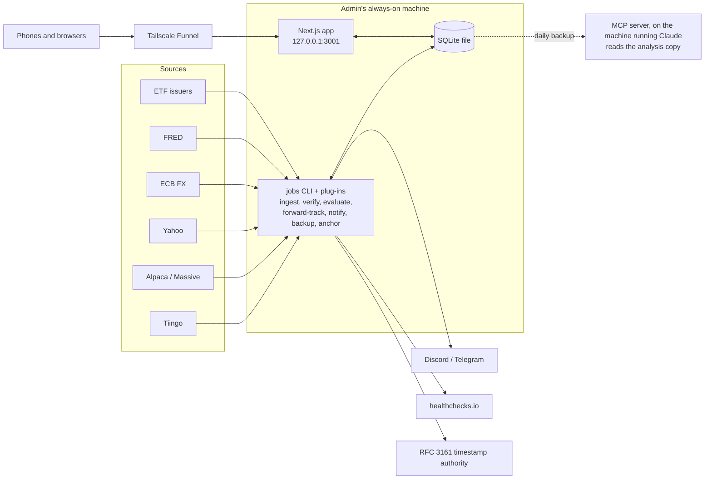
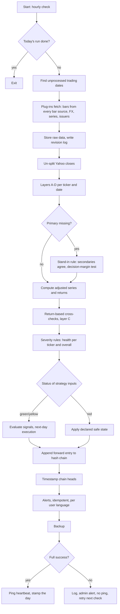

# System design (v0.4, Saku)

How Saku is built. Stage A is designed in detail; later stages are outlined and detailed at their stage reviews. Requirements live in `docs/requirements/`. The structure follows the owner's other app, Tora: a generic public repo, plug-ins for everything particular to a place, provider or person, and private specifics in a submodule.

## 1. Components



| Component | Responsibility | Stage |
|---|---|---|
| `packages/plugin-sdk` | Plug-in contracts, polite HTTP client, jobs CLI | A1 |
| `plugins-public/`, `plugins/` | Source plug-ins (public, private), tax regimes, templates | A1, C1 |
| `packages/data` | Verification layers, severity rules, stand-in rule, fault injection, calendars | A |
| `packages/db` | Schema, migrations, queries, user CLI, seed, backup and restore | A1 |
| `packages/auth` | Passwords, TOTP, backup codes, secret encryption | A1 (tables, CLI), D1 (UI) |
| `packages/core` | Engine: adjusted series, indicators, signals, strategies, execution models, backtests, tax engine | A2 (minimal), B, C |
| `packages/reference` | Independent core math (not tax) | B1 |
| `packages/analytics` | Robustness, overfitting statistics, Monte Carlo, finder | B3, F3 |
| `apps/web` | UI, server actions (light only), admin pages | D (admin bits earlier as needed) |
| `packages/mcp` | Read-only MCP server | E |

## 2. Product model and infrastructure
- **A closed install for a few accounts.** No sign-up page; the first admin is made with `pnpm user create`; admins manage accounts in the app. Each person's data is scoped by `owner_id`; market data, checks, health, plug-in descriptions and the library are shared.
- **Self-hosted.** Everything runs on one always-on machine as systemd services under the admin's user. The owner's: a mini PC (Intel N150, 16 GB, 500 GB SSD, Ubuntu Server 24.04), shared with Tora (port 3000, nightly collect after midnight JST, a VNC display).
- **Reached through Tailscale Funnel** (owner: `tailscale funnel --bg --https=8443 3001`). Tora's watchdog resets all Funnel mappings when its address fails, so it re-adds Saku's (maintained on the Tora side).

| Environment | Where | Purpose |
|---|---|---|
| Local | Developer's PC (WSL), SQLite file, `pnpm db:seed` demo data | Development and tests on synthetic data |
| CI | GitHub Actions on the public repo | Lint, typecheck, tests, build, coverage gates; synthetic data only, no secrets; jobs refuse to run here |
| Production | The admin's machine | App, database, jobs, backups, `pnpm verify` on real data |

**Secrets** (the server's `.env` only): `AUTH_SECRET` (signs sessions, encrypts TOTP secrets and alert channel targets; kept in a password manager, a restored database needs the same one), provider keys (`TIINGO_API_KEY`, `FRED_API_KEY`, `ALPACA_*`, `MASSIVE_API_KEY`), `HEALTHCHECK_URL`, `TELEGRAM_BOT_TOKEN` (one bot per install). Alert targets (webhook addresses, chat ids) are stored encrypted in `notification_channels`, admins' operational channels flagged there.

## 3. Schedules (systemd timers, server time zone)
The US close is 05:00 or 06:00 JST (summer/winter). A1 measures when each bar source's data is final.

| Unit | Timer | Does |
|---|---|---|
| `saku-daily` | hourly (`OnCalendar=*-*-* *:20:00`, `Persistent=true`) | Once per trading day, at the first check after data is final: ingest, verify, evaluate, forward entries, alerts, timestamp, backup, admin alerts. A run that did not finish runs again at the next check. Exits at once when the day is done. |
| `saku-weekly` | Sunday 10:37 | Full refetch, revision diff, full recomputation, `pnpm verify` (core vs reference, parity, incremental vs full on real data) |
| `saku-monthly` | 1st, 11:47 | Audit report |
| `saku-update` | every 5 min | Pull both repos, install, migrate, build, restart, check; roll back and alert on failure; never while a job runs |
| `saku-app` | service | Web app on `127.0.0.1:3001` |
| Key-day (F1) | around 21:00 | Post-v1 |

Each job has its own stamp and lock in `~/.local/state/saku/`. Heavy jobs run with `Nice=10` and a `CPUQuota`. Saku's daily run (morning) and Tora's collect (after midnight) do not overlap.

## 4. Daily pipeline



**State per trading date and ticker:** `pending` -> `fetched` -> `verified` (green/yellow/red) -> `evaluated` -> `notified`.

**Idempotency:** alerts keyed by (strategy version, trading date, alert type); forward entries keyed by (version, date).

## 5. Data model

SQLite through Drizzle. Prices and returns as `real` (float64); money, tax and quota amounts as decimal `text` with a currency column; trading dates as `text` (`YYYY-MM-DD`, America/New_York); timestamps as ISO 8601 `text`. Enum columns with CHECK constraints. Migrations add first and drop in a later migration.

Stage A tables (A1 creates the market data, auth, settings and operations tables; `issuer_records` comes with A3 and the strategy, forward record, journal and channel tables with A2):

| Table | Key columns | Notes |
|---|---|---|
| `users` | id, username, password_hash, totp_secret (encrypted), is_admin, disabled, language | |
| `user_devices` | id, user_id, label, created_at, last_seen_at, revoked_at | Max 2 active |
| `backup_codes`, `login_attempts` | | Auth |
| `app_settings` | key, value | Install-wide admin settings (base currency, time zone, languages, regime, ...) |
| `user_settings` | owner_id, example_amount, defaults (json) | Per user |
| `plugin_info` | key, kind, description (json), saved_at | Written by each job run |
| `source_roles` | data_kind, plugin_key, role, position | Admin's choice |
| `symbols` | id, ticker, tier, asset_class, leverage_factor, underlying_symbol_id, index_series, issuer, inception_date, active | Leverage, underlying and index series drive layer C |
| `bars_raw` | symbol_id, date, source, open, high, low, close, close_is_split_adjusted, volume, div_cash, split_factor, provider_adj_close, fetched_at; PK (symbol_id, date, source) | Never deleted |
| `bars` | symbol_id, date, open, high, low, close (unadjusted), volume, div_cash, split_factor, adj_close (ours: forward-accumulated total-return index), source, stand_in, status; PK (symbol_id, date) | Canonical |
| `bar_revisions` | id, symbol_id, date, source, field, old_value, new_value, detected_at, run_id | Raw fields only |
| `readjustments` | id, symbol_id, source, from_date, to_date, factor, detected_at, run_id | One row per provider re-adjustment of adjusted values |
| `issuer_records` | symbol_id, date, nav, distribution_amount, ex_date, split_ratio, source_url, fetched_at | Best effort |
| `fx_rates` | pair, date, source, kind (valuation, tax_mid, tax_buy, tax_sell), rate, published_at, known_at, fetched_at; PK (pair, kind, date, source, known_at, fetched_at) | Valuation vs tax rates kept separate; generic tax kinds, each regime maps its names (TTM/TTS/TTB) onto them. A new value for a date and publication time is a new row (vintage); `known_at` = `published_at`, else `fetched_at`, so `asOf` returns what was known at any moment |
| `series` | series, date, value, source, published_at, known_at, fetched_at; PK (series, date, source, known_at, fetched_at) | Rates, index, later macro; kept by vintage like `fx_rates`; `known_at` serves `asOf` |
| `check_results` | id, run_id, layer, check_name, symbol_id, source, date, status, observed, expected, tolerance, message | Daily: all in the window; full-history passes (bootstrap, `checks`, weekly): non-green only |
| `check_summaries` | run_id, layer, check_name, checked, passed, max_deviation | Full-history passes |
| `stand_ins` | symbol_id, date, source, close, band, basis, run_id, created_at, primary_close, deviation, resolved_at, resolved_run_id; PK (symbol_id, date) | Secondary bars used for a missing primary day; resolved when the primary arrives |
| `data_health` | id, run_id, date, symbol_id (null = overall), status, reasons | Daily: all in the window; full passes: non-green symbol rows and every graded date's overall row |
| `health_coverage` | run_id, symbol_id, from_date, to_date; PK (run_id, symbol_id) | Full passes: the dates graded per symbol (a missing non-green row is green only inside) |
| `strategies` | id, owner_id, name, yaml, status (draft), updated_at | Drafts: no forward record |
| `strategy_versions` | id, owner_id (null = library), strategy_id, name, canonical_json, registered_at, hash | Immutable |
| `forward_annotations` | id, version_id, date, kind, detail, run_id, created_at | Append-only; corrections and recomputations |
| `forward_entries` | version_id, date, payload (canonical JSON text as hashed), signal_state, holdings, safe_state_applied, equity, data_status, prev_hash, hash; PK (version_id, date) | Append-only |
| `chain_anchors` | id, chain_head_hash, anchored_at, method (rfc3161), authority, proof | |
| `journal_entries` | owner_id, version_id, signal_date, action (done/skipped/delayed), action_date, note | CLI in A2, UI in D1 |
| `notification_channels` | id, owner_id, type (the `Notifier` plug-in key), target_enc, admin, enabled | Per user; admin channels flagged; disabled, never deleted |
| `alerts_sent` | owner_id, channel_id, subject (version id or job type), date, type, allocation, sent_at; unique (channel, subject, date, type) | Idempotency; `allocation` is what the channel was last told |
| `job_runs` | id, job_type (daily, weekly, monthly, bootstrap, checks), started_at, finished_at, status, dates_processed, error, heartbeat_sent | |
| `provider_usage` | provider, window_type, window_start, request_count, unique_symbols | Quota guard |
| `activity_log` | id, at, actor, action, detail | Admin tasks, updates, resets |

Every user-owned table has `owner_id`; every query on it is scoped in `packages/db` query functions that take the signed-in user, and tests call each server action as another user. Market data tables are global; only jobs write them. Later stages add (all with `owner_id`) tax accounts, trades, cash balances, tax lots, quota ledger, loss carryforward, paper portfolios, alerts, robustness reports, finder results.

Calendars (NYSE, bond market, ECB) are versioned files from `CalendarSource` plug-ins.

## 6. Key interfaces (sketches)

```ts
interface PluginInfo {
  key: string; kind: PluginKind; name: string; provides: unknown; suggestedRole: 'primary' | 'secondary' | 'check';
  limits?: { perMinute?: number; perHour?: number; perDay?: number; symbolsPerMonth?: number };
  keyEnv?: string; termsUrl: string; noAi?: boolean; unofficial?: boolean;
}
interface PluginContext { http: PoliteHttp; now: Date; log: Logger; }
interface BarSource { info: PluginInfo; fetchBars(ticker: string, from: TradingDate, to: TradingDate, ctx: PluginContext): Promise<RawBar[]>; } // RawBar flags split-adjusted closes
interface SeriesSource { info: PluginInfo; fetchSeries(id: string, from: TradingDate, to: TradingDate, ctx: PluginContext): Promise<SeriesPoint[]>; } // with publishedAt when known
interface FxSource { info: PluginInfo; fetch(pair: string, from: TradingDate, to: TradingDate, ctx: PluginContext): Promise<FxRate[]>; }
interface IssuerSource { info: PluginInfo; supports(ticker: string): boolean; fetchRecords(ticker: string, from: TradingDate, to: TradingDate, ctx: PluginContext): Promise<IssuerRecord[]>; }
interface TaxRegime { info: PluginInfo; accountTypes: AccountType[]; rules: RegimeRules; } // declarative, C1
interface Check { id: string; layer: 'A'|'B'|'C'|'D'|'E'; run(ctx: CheckContext): CheckResult[]; } // pure
type HealthStatus = 'green' | 'yellow' | 'red';
interface Notifier { info: NotifierInfo; validTarget(target: string): boolean; send(target: string, text: string, ctx: PluginContext): Promise<void>; } // A2; text already in the user's language
type Execution = 'next_open' | 'next_close' | 'same_close';
```

A plug-in package's `src/index.ts`: `export const bars: BarSource[] = [...]; export const series: SeriesSource[] = []; ...` (only the kinds it has).

## 7. Verification architecture
- **Registry of pure checks** over a context (all sources, issuer records, FX, series, calendars, metadata). The **severity aggregator** maps results to health per the rules in 04, including the stand-in rule.
- **Yahoo handling:** closes are un-split using recorded split events before comparison; adjusted series compared on daily returns, not levels.
- **Layer C tolerance:** 0.5pp plus 10% of the absolute expected move, adjusting for ex-dividend days (leveraged ETFs track the index, not SPY).
- **Point-in-time:** `asOf(series, date)` is the only way core reads rates, FX and index values, live and in backtests.
- **Fault injection harness:** applies one material mutation at a time to clean synthetic data and asserts detection and no normal signal; a separate test asserts single-source days are never green.
- **Reference implementation:** core math only, written in a separate session; compared in CI (synthetic) and weekly on real data (`pnpm verify`), with the near-tie rule.

## 8. Integrity: registration and hash chain
- Canonical form: RFC 8785 (JCS) JSON of the zod-parsed object. The exact hashed text is stored (`canonical_json`, `payload`), so database round-trips never change what is verified. This format never changes; a change would need a new chain version.
- Registering writes `strategy_versions` with `hash = sha256(canonical_json)`, where the JSON is `{kind: registration, owner, name, registeredAt, strategy}`. Registration and the forward record open only once the admin sets `forward_records_from` (after the A1 gate); the record starts with the first close after registration.
- Each `forward_entries` row stores `payload` (canonical JSON including `prevHash`: the previous entry's hash, or the version's hash for the first entry) and `hash = sha256(payload)`. The columns (allocation, holdings, safe state, data status, equity) repeat the payload for queries; verification checks they match. `strategy_versions`, `forward_entries`, `forward_annotations` and `chain_anchors` are append-only: SQLite triggers refuse updates and deletes.
- Daily, the chain heads are timestamped by an RFC 3161 timestamp authority (`openssl ts`, no npm dependency; a second authority as fallback) and recorded in `chain_anchors`. Signed git tags are not used: they prove who, not when.
- `pnpm strategy verify` recomputes every chain and checks the stored text matches the structured columns (timestamp tokens join with the RFC 3161 anchors); status on the admin page and in the MCP later.
- Each day's entry: the decision at the close with the data health of every dependency (signal tickers and anything the strategy may hold). Yellow: the decision with its reasons. Red, or stand-in prices that could flip a signal within their bands (decision-margin test: every corner of the bands of all of the day's stand-ins together, more than 4 is red): the declared safe state, recorded as such. Missed days are caught up in order. A stand-in later corrected by the primary adds a `stand_in_corrected` annotation (recorded vs corrected allocation), never an edit.
- Every daily run evaluates each recorded day again with the current engine on today's canonical bars (`pnpm strategy recompute` by hand). A different allocation or signal adds a `recomputed` annotation naming the commit, once per distinct result, and an admin alert; the entry is never edited. A difference can come from the engine or from data corrected since; the cause is found before new signals are trusted.

## 9. Numerics and time
- Trading dates are `YYYY-MM-DD` strings (America/New_York), never `Date` objects in core logic. Display in the install's time zone.
- 252-day annualization; float64 analytics (1e-9 relative tolerance); decimal.js money and tax.
- Near-tie rule: within 1e-9 relative, keep the previous state.
- Synthetic leverage and USD cash use `asOf` of the series a series plug-in declares as the USD cash rate (`provides.cashRates.USD`; FRED: `DTB3`) converted to a daily rate (unknown stays unknown, never 0%); base-currency cash uses the deposit rate setting.

## 10. Compute placement
Library evaluation, robustness sweeps and Monte Carlo run in server jobs (results stored) or in the browser via Web Workers. Server actions only serve light requests.

## 11. Error handling and observability
Job runs and structured logs in `~/.local/state/saku/`; admin alert with the reason on failure; no heartbeat ping, so healthchecks.io alerts independently; retries, stand-in rule, then `pending`. Admin pages: server status (version, uptime, memory, disk, units, last runs, log tails), activity log, data health, quotas, chain status.

## 12. Security
No sign-up; password + TOTP + backup codes; 2 devices per account; lockout; authorization in every server action and route; `owner_id` scoping with wrong-user tests; secrets only in the server's `.env`; TOTP secrets and alert targets encrypted with `AUTH_SECRET`; the app listens on localhost only and is reached through Funnel; MCP reads a read-only copy; dependency and license checks; Next.js kept patched.

## 13. CI/CD
- Push: GitHub Actions runs lint, typecheck, tests (synthetic), fault injection, core vs reference (synthetic), chain tests, coverage gates, `pnpm docs:check`, build.
- Deploy: the server's update timer pulls, migrates and restarts (rolls back on failure). The owner pushes; Claude commits only.

## 14. Architecture decision records
| ADR | Decision | Reason |
|---|---|---|
| 001 | Monorepo, pnpm workspaces | Shared types across jobs, web, MCP |
| 002 | Next.js | One app for UI and server actions, React underneath |
| 003 | ~~Supabase (Tokyo)~~ superseded by 011 | |
| 004 | ~~GitHub Actions for jobs~~ superseded by 011 | |
| 005 | Indicators computed locally | Determinism, exact definitions |
| 006 | Reference implementation for core math only | Independent check where it adds value; tax verified by owner cases |
| 007 | float64 analytics, decimal money | Speed and exactness |
| 008 | ~~Single owner, Supabase RLS~~ superseded by 012 | |
| 009 | Next-day execution default | Realistic for a user who cannot trade at the close |
| 010 | Hash-chained forward records with external timestamps (RFC 3161) | Provable, tamper-evident track records |
| 011 | Self-hosted on the admin's machine: SQLite (libSQL + Drizzle), systemd timers, Tailscale Funnel | No free-tier limits, home connection for sources, the owner's proven Tora setup |
| 012 | A few accounts per install, own auth, `owner_id` scoping in the query layer | Family use; SQLite has no row-level security |
| 013 | Plug-ins for everything particular to a country, provider or person; public and private (submodule) | Template-worthy public repo; bring your own data |

New ADRs go to `docs/adr/`.

## 15. Open items for Stage A
- Data finalization times per bar source; secondary availability over 20 trading days.
- Alpaca: free consolidated daily bars since 2016, 200 calls/min; corporate actions coverage; whether a paper-only account is open to residents of Japan.
- Massive (formerly Polygon): free end-of-day, 2 years, 5 calls/min, individual use; whether the grouped daily endpoint is on the free plan.
- Each provider's terms on giving data to AI models (`noAi`); Tiingo runs its own MCP server for AI agents, but its terms decide.
- ECB rate timing and USD/JPY cross derivation details.
- Issuer data availability per Tier 0 ETF.
- Which RFC 3161 authorities (terms, availability).
