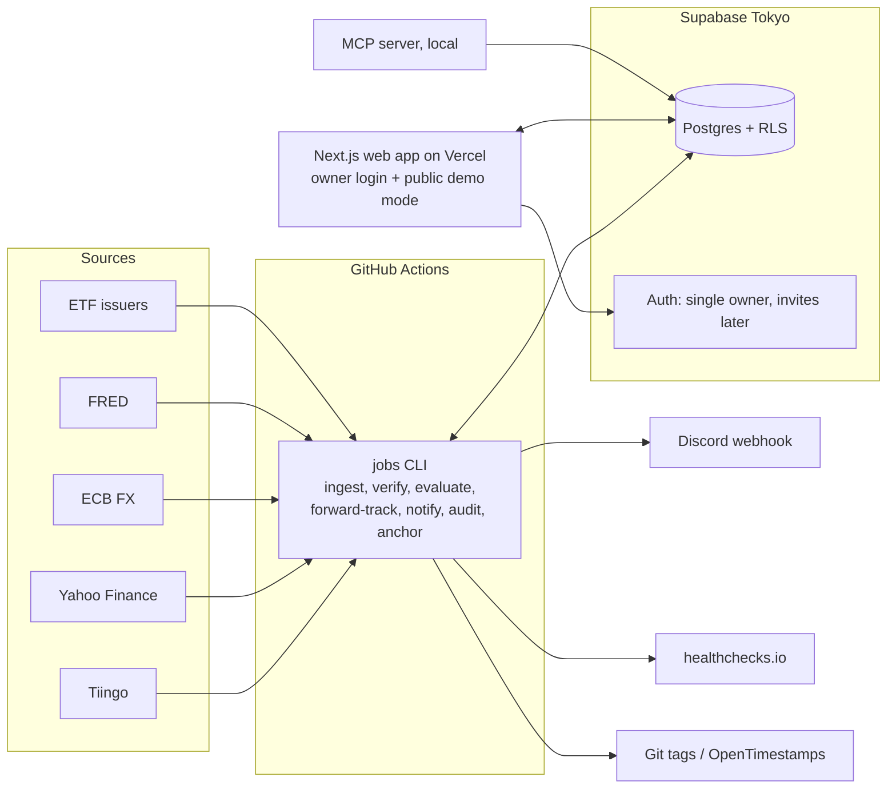
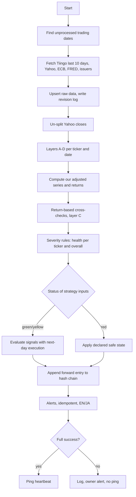

# System design (v0.3, Saku)

How Saku is built. Stage A is designed in detail; later stages are outlined and detailed at their stage reviews. Requirements live in `docs/requirements/`.

## 1. Components



| Component | Responsibility | Stage |
|---|---|---|
| `apps/jobs` | Scheduled pipeline, heavy computation, chain anchoring | A, B |
| `packages/data` | Adapters, verification layers, severity rules, fault injection, calendar | A |
| `packages/core` | Engine: adjusted series, indicators, signals, strategies, execution models, backtests, tax | A2 (minimal), B, C |
| `packages/reference` | Independent core math (not tax) | B1 |
| `packages/analytics` | Robustness, overfitting statistics, Monte Carlo, finder | B3, F3 |
| `apps/web` | UI, API routes (light only), demo mode | D |
| `apps/mcp` | Read-only MCP server | E |

## 2. Product model and infrastructure
- **Single owner per instance.** One Supabase Auth account protects the owner's instance. Public visitors see demo mode (synthetic data bundled with the app, no database access). Others self-host by forking.
- **Multi-user-ready:** user-owned tables carry `owner_id` with RLS policies tied to `auth.uid()`; market data tables are global. Adding family later means enabling Supabase invites and a small settings UI, no migration.
- Provider keys live in GitHub Actions secrets and Vercel env vars at instance level, because market data is shared by all users of an instance.

| Environment | Where | Purpose |
|---|---|---|
| Local | Docker Compose + Supabase CLI | Development and tests with recorded data |
| CI | GitHub Actions | Lint, typecheck, tests, build, coverage gates; no live API calls |
| Production | Vercel (web), Supabase free in Tokyo (DB, Auth), GitHub Actions (jobs), owner's machine (MCP) | Daily operation |

Vercel preview deployments use demo mode only. Total cost: ¥0.

**Secrets:** `TIINGO_API_KEY`, `FRED_API_KEY`, `SUPABASE_URL`, `SUPABASE_ANON_KEY`, `SUPABASE_SERVICE_ROLE_KEY` (jobs only), `DISCORD_WEBHOOK_URL`, `HEALTHCHECK_URL`, `ANCHOR_SIGNING_KEY` (if signed git tags are chosen).

## 3. Schedules (UTC; GitHub cron is UTC)
The US close is 20:00 UTC in summer and 21:00 UTC in winter. A1 measures when Tiingo and Yahoo data is final; defaults below leave a buffer for both.

| Job | Cron (UTC) | JST | Notes |
|---|---|---|---|
| Daily primary | `17 23 * * 1-5` | 08:17 Tue-Sat | Ingest, verify, evaluate, notify, chain entry |
| Daily retry | `17 3 * * 2-6` | 12:17 | Anything still `pending` |
| Weekly | `37 1 * * 0` | Sun 10:37 | Full refetch, revision diff, full recomputation, reference comparison on live data, chain anchor |
| Monthly audit | `47 2 1 * *` | 1st, 11:47 | Audit report |
| Keep-alive | monthly | | Prevents scheduled workflows being disabled |
| Key-day (F1) | `0 12 * * 1-5` | 21:00 | Post-v1 |

All jobs are idempotent and catch up on every unprocessed trading day.

## 4. Daily pipeline



**State per trading date and ticker:** `pending` -> `fetched` -> `verified` (green/yellow/red) -> `evaluated` -> `notified`.

**Idempotency:** alerts keyed by (strategy version, trading date, alert type).

## 5. Data model

Stage A tables:

| Table | Key columns | Notes |
|---|---|---|
| `symbols` | id, ticker, tier, asset_class, leverage_factor, underlying_symbol_id, issuer, inception_date, active | Leverage and underlying drive layer C |
| `bars_raw` | symbol_id, date, source, open, high, low, close, close_is_split_adjusted, volume, div_cash, split_factor, provider_adj_close, fetched_at; PK (symbol_id, date, source) | Never deleted |
| `bars` | symbol_id, date, open, high, low, close (unadjusted), volume, div_cash, split_factor, adj_close (ours), primary_source, status; PK (symbol_id, date) | Canonical |
| `bar_revisions` | id, symbol_id, date, source, field, old_value, new_value, detected_at, run_id | |
| `issuer_records` | symbol_id, date, nav, distribution_amount, ex_date, split_ratio, source_url, fetched_at | Best effort |
| `fx_rates` | pair, date, source (ecb, yahoo, fred, broker_ttm/tts/ttb), rate, fetched_at; PK (pair, date, source) | Valuation vs tax rates kept separate |
| `rates` | series (DTB3, JPY_DEPOSIT), date, value, source | |
| `check_results` | id, run_id, layer, check_name, symbol_id, date, status, observed, expected, tolerance, message | |
| `data_health` | date, symbol_id (null = overall), status, reasons, run_id | |
| `strategies` | id, owner_id, name, yaml, status (draft), updated_at | Drafts: no forward record |
| `strategy_versions` | id, owner_id, strategy_id, yaml, registered_at, hash | Immutable; library versions have owner_id null (shared) |
| `forward_entries` | version_id, date, signal_state, holdings, safe_state_applied, equity, data_status, prev_hash, hash; PK (version_id, date) | Append-only hash chain |
| `chain_anchors` | id, chain_head_hash, anchored_at, method, proof | External timestamps |
| `journal_entries` | owner_id, version_id, signal_date, action (done/skipped/delayed), action_date, note | CLI in A2, UI in D1 |
| `user_settings` | owner_id, language, base_currency, example_amount, nisa_enabled, defaults (jsonb) | One row per user |
| `notification_channels` | id, owner_id, type (discord), target (encrypted webhook URL), language, enabled | Per-user alerts |
| `job_runs` | id, job_type, started_at, finished_at, status, dates_processed, error, heartbeat_sent | |
| `provider_usage` | provider, window_type, window_start, request_count, unique_symbols | Quota guard |

`forward_entries` inherit ownership through their version (RLS via join). Market data tables (`symbols`, `bars*`, `fx_rates`, `rates`, `check_results`, `data_health`, `issuer_records`, `job_runs`, `provider_usage`) are global and readable by authenticated users; only jobs write them.

The NYSE calendar is a versioned file in `packages/data/calendar/`. Prices stored as `numeric`; parsed to float64 for analytics and decimal.js for money. Later stages add (all with owner_id) trades, cash balances, tax lots, NISA quota ledger, paper portfolios, alerts, robustness reports, finder results, event calendar.

## 6. Key interfaces (sketches)

```ts
interface DataProvider {
  id: 'tiingo' | 'yahoo';
  fetchBars(ticker: string, from: TradingDate, to: TradingDate): Promise<RawBar[]>; // RawBar flags split-adjusted closes
}
interface FxProvider { id: 'ecb' | 'yahoo' | 'fred' | 'broker'; fetch(pair: 'USDJPY', from: TradingDate, to: TradingDate): Promise<FxRate[]>; }
interface IssuerAdapter { issuer: string; supports(ticker: string): boolean; fetchRecords(ticker: string, from: TradingDate, to: TradingDate): Promise<IssuerRecord[]>; }
interface Check { id: string; layer: 'A'|'B'|'C'|'D'|'E'; run(ctx: CheckContext): CheckResult[]; } // pure
type HealthStatus = 'green' | 'yellow' | 'red';
interface Notifier { send(alert: LocalizedAlert): Promise<void>; }
type Execution = 'next_open' | 'next_close' | 'same_close';
```

## 7. Verification architecture
- **Registry of pure checks** over a context (all sources, issuer records, FX, calendar, metadata). The **severity aggregator** maps results to health per the rules in 04.
- **Yahoo handling:** closes are un-split using recorded split events before comparison; adjusted series compared on daily returns, not levels.
- **Layer C tolerance:** 0.5pp plus 10% of the absolute expected move, adjusting for ex-dividend days (leveraged ETFs track the index, not SPY).
- **Fault injection harness:** applies one material mutation at a time to clean recorded data and asserts detection and no normal signal.
- **Reference implementation:** core math only, written in a separate session; compared in CI and weekly on live data, with the near-tie rule.

## 8. Integrity: registration and hash chain
- Registering a draft writes `strategy_versions` with `hash = sha256(canonical YAML + registered_at)`.
- Each daily `forward_entries` row stores `prev_hash` and `hash = sha256(prev_hash + canonical entry)`.
- Weekly, the latest chain heads are anchored externally (signed git tag in the repo, or OpenTimestamps; decided in A2) and recorded in `chain_anchors`.
- A verification command recomputes the chain and checks anchors; status shown in the admin page and MCP.

## 9. Numerics and time
- Trading dates are `YYYY-MM-DD` strings (America/New_York), never `Date` objects in core logic.
- 252-day annualization; float64 analytics (1e-9 relative tolerance); decimal.js money and tax.
- Near-tie rule: within 1e-9 relative, keep the previous state.
- Synthetic leverage and USD cash use DTB3 converted to a daily rate; JPY cash uses the configured deposit rate.

## 10. Compute placement
Library evaluation, robustness sweeps and Monte Carlo run in GitHub Actions jobs (results stored) or in the browser via Web Workers. Vercel functions only serve light API calls.

## 11. Error handling and observability
Job runs and structured logs; owner alert with run link on failure; no heartbeat ping, so healthchecks.io alerts independently; retries, fallback source, then `pending`.

## 12. Security
RLS on all user-owned tables (owner_id = auth.uid()); single owner account today; webhook URLs encrypted at rest; service-role key only in jobs; MCP uses a read-only credential; demo mode has no database access; dependency and license checks.

## 13. CI/CD
- PR: lint, typecheck, tests, fault injection, core vs reference, chain tests, coverage gates, `REQUIREMENTS.md` up to date, build.
- Merge: Vercel deploys; Supabase migrations via a manually approved workflow.

## 14. Architecture decision records
| ADR | Decision | Reason |
|---|---|---|
| 001 | Monorepo, pnpm + Turborepo | Shared types across jobs, web, MCP |
| 002 | Next.js over plain React SPA | One deployable, native Vercel support, React underneath |
| 003 | Supabase (Tokyo) | Free Postgres, Auth, RLS, close to the owner |
| 004 | GitHub Actions for jobs and heavy compute | Free, versioned; no serverless time limits |
| 005 | Indicators computed locally | Determinism, exact definitions |
| 006 | Reference implementation for core math only | Independent check where it adds value; tax verified by owner cases |
| 007 | float64 analytics, decimal money | Speed and exactness |
| 008 | Single owner today with a multi-user-ready data model; provider keys at instance level | Matches the product model; family can be added without migration; market data is shared |
| 009 | Next-day execution default | Realistic from Japan |
| 010 | Hash-chained forward records with external anchoring | Provable, tamper-evident track records |

New ADRs go to `docs/adr/`.

## 15. Open items for Stage A
- Data finalization times for Tiingo and Yahoo; Yahoo availability from GitHub Actions.
- ECB rate timing and USD/JPY cross derivation details.
- Issuer data availability per Tier 0 ETF.
- Supabase behavior over ≥ 10 days.
- Anchoring method (signed git tags vs OpenTimestamps).
